# NT547 - LAB 06 - BÁO CÁO

| Thông tin | Nội dung |
|---|---|
| **MSSV** | 24521005 |
| **Họ tên** | Nguyễn Hoàng Long |
| **Lớp** | NT547.R11.ANTT |
| **Session code tự sinh** | SC-015C17 |
| **Tên contract** | StakingPool_1005 |
| **Solidity / Slither** | 0.8.24 / 0.11.6 |
| **Ngày hoàn thành** | 20/11/2026 |
| **URL GitHub repository** | https://github.com/Longtemp145/nt547-lab06 |

Em làm bài trên WSL2 Ubuntu, dùng Python 3.12.7 trong venv, solc 0.8.24 (cài bằng solc-select) và Graphviz 2.43.0. Trước khi bắt đầu em chạy `tools/preflight.py`, kết quả báo đủ công cụ và đủ file (Hình 1). Sau đó em sinh contract bằng `python tools/create_lab.py 24521005`, nhận được contract `StakingPool_1005` và mã phiên `SC-015C17`; `lab_identity.json` ghi baseline_sha256 = `d1883023e98a0d63b293c8fce1d3df499befdd9ec2443c7237c2a79b831b901f` (Hình 2).

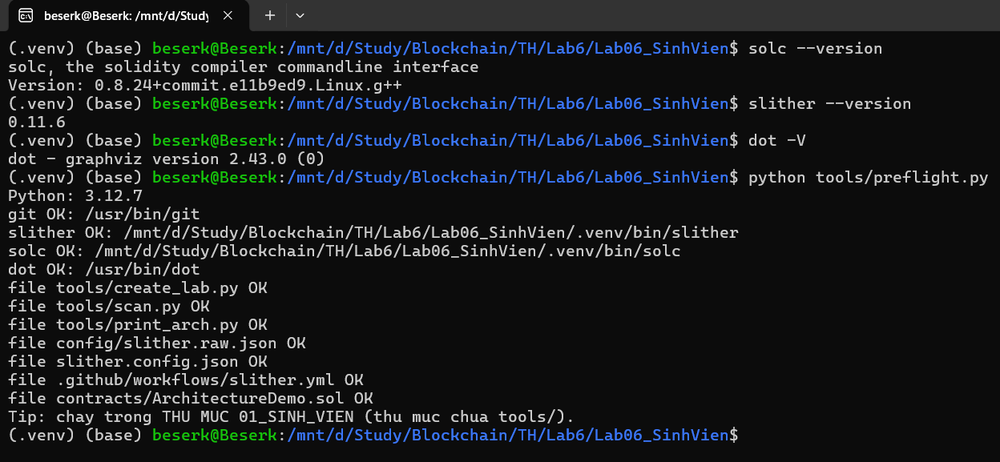
*Hình 1 – Kiểm tra phiên bản solc, Slither, Graphviz và chạy preflight.*

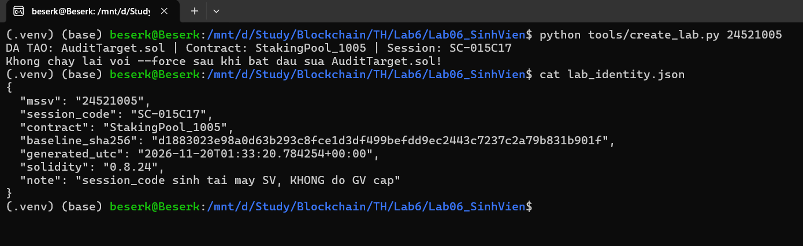
*Hình 2 – Sinh contract theo MSSV và nội dung lab_identity.json.*

## 1. Static scan (2,0 điểm)

- Lệnh raw: `python tools/scan.py --mode raw --tag before`. Bên trong script gọi `slither AuditTarget.sol --config-file config/slither.raw.json --fail-none --json evidence/before_raw/slither.json`, nên dù có lỗi High thì process vẫn trả về 0 (`process_exit_code: 0`).
- Số lượng finding raw, lấy từ `evidence/before_raw/summary.json` (tổng **11**):
  - High: **2**; Medium: **3**; Low: **1**; Informational: **5**; Optimization: **0**
- Chạy configured: `python tools/scan.py --mode configured --tag before`, ra **5** finding (High 2, Medium 3, Low 0, Informational 0) (Hình 3).
- So sánh raw và configured: file `slither.config.json` chỉ bật `exclude_low`, `exclude_informational` và bỏ detector `solc-version`. Vì vậy 6 finding biến mất đều là loại nhẹ: 1 `timestamp` (Low), 4 `low-level-calls` và 1 `naming-convention` (Informational). Cả 2 High và 3 Medium vẫn còn nguyên. Nói cách khác, config chỉ giúp bớt nhiễu chứ không giấu được lỗi nặng; muốn CI xanh thì vẫn phải sửa code.
- 3 detector **khác tên** em chọn để phân tích: `reentrancy-eth`, `tx-origin`, `unchecked-lowlevel`.

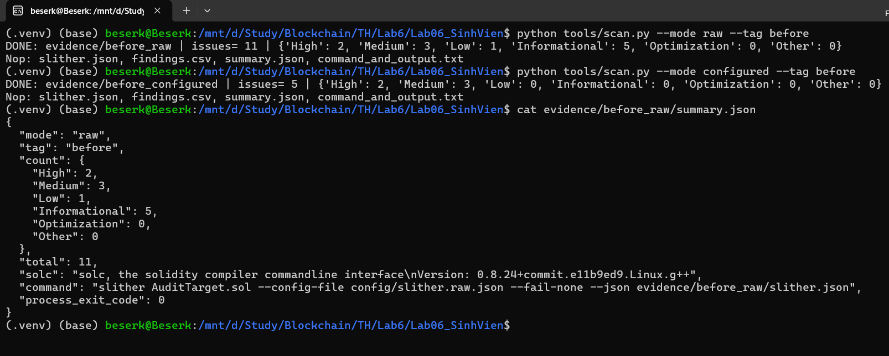
*Hình 3 – Scan BEFORE ở chế độ raw (11) và configured (5), kèm nội dung summary.json.*

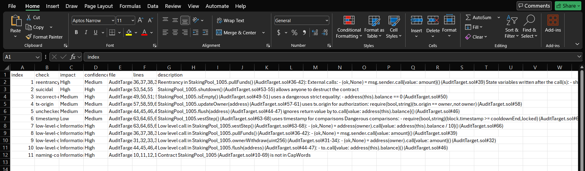
*Hình 4 – File evidence/before_raw/findings.csv mở bằng Excel, đủ 11 finding.*

| ID finding | Detector | Impact | Confidence | Source (file:dòng) | Luồng dữ liệu: đầu vào -> thao tác -> tác hại |
|---|---|---|---|---|---|
| F01 | reentrancy-eth | High | Medium | AuditTarget.sol:36-42 (`pullFunds`; call ở dòng 39, ghi `shares` ở dòng 41) | Người gọi (có thể là một contract) gọi `pullFunds()` -> contract đọc `amount = shares[msg.sender]` rồi gửi ETH bằng `msg.sender.call` **trước** khi đặt `shares[msg.sender] = 0` -> hàm `receive()` của kẻ gọi được chạy và gọi lại `pullFunds()`, lúc này `shares` vẫn chưa bị xoá nên tiếp tục được trả tiền -> pool bị rút cạn, kể cả tiền của người khác. |
| F02 | tx-origin | Medium | Medium | AuditTarget.sol:57-61 (`updateOwner`; kiểm tra ở dòng 58) | Owner bị dụ tương tác với một contract độc hại -> contract đó gọi `updateOwner(attacker)` -> vì giao dịch do owner ký nên `tx.origin == owner` và điều kiện vẫn đúng, dù người gọi trực tiếp là contract lạ -> `owner = attacker`, kẻ tấn công có luôn quyền `flush`, `ownerWithdraw`, `vestStep`. |
| F03 | unchecked-lowlevel | Medium | Medium | AuditTarget.sol:44-47 (`flush`; call ở dòng 46) | Owner gọi `flush(to)` -> `to.call{value: balance}("")` có thể thất bại (địa chỉ nhận revert hoặc hết gas) -> kết quả trả về bị bỏ qua nên giao dịch vẫn báo thành công -> owner tưởng đã chuyển tiền nhưng ETH vẫn nằm trong contract, sổ sách off-chain bị lệch mà không có lỗi nào báo ra. |

## 2. Triage và sửa lỗi (2,5 điểm)

Em đọc lại toàn bộ AuditTarget.sol bản gốc và thấy có **4 lỗi thật**: reentrancy ở `pullFunds`, `selfdestruct` không kiểm soát quyền ở `shutdown`, dùng `tx.origin` để phân quyền ở `updateOwner`, và không kiểm tra kết quả `call` ở `flush`. Ngoài ra có **2 đoạn phải xét theo ngữ cảnh**: so sánh `address(this).balance == 0` ở `isEmpty` và dùng `block.timestamp` cho timelock ở `vestStep`. Cả 6 chỗ đều có detector báo, nên em không có mục nào phải ghi "Manual review / Not reported".

| Detector + vị trí | TP / FP / Chưa kết luận | Bằng chứng kiểm soát/khả năng khai thác | Biện pháp (Fix / Accept có lý do) | Sau sửa |
|---|---|---|---|---|
| `reentrancy-eth` – `pullFunds` L36-42 | **TP** | Hàm `external`, không có modifier nên ai cũng gọi được. Lệnh `call` gửi tiền cho `msg.sender` (do kẻ tấn công kiểm soát) chạy trước khi ghi `shares = 0` ở dòng 41. Biến `shares` còn được dùng ở `save()`. Khai thác được, kịch bản ở dưới. | **Fix**: làm theo Checks-Effects-Interactions, đưa `shares[msg.sender] = 0;` lên trước `call`, vẫn giữ `require(ok)`. | Hết finding; chỉ còn Info `low-level-calls` (chấp nhận). |
| `suicidal` – `shutdown` L53-55 | **TP** | `selfdestruct(payable(msg.sender))` không có kiểm soát quyền, ai gọi cũng lấy được toàn bộ ETH của pool. Từ bản Cancun (EIP-6780), selfdestruct không còn xoá code nhưng vẫn chuyển hết ETH đi. | **Fix**: xoá hẳn hàm `shutdown()`, vì nghiệp vụ của pool không cần huỷ contract. | Hết finding. |
| `tx-origin` – `updateOwner` L57-61 | **TP** | Kiểm tra quyền bằng `tx.origin` nên bị phishing qua contract trung gian như F02, hậu quả là mất quyền owner. | **Fix**: đổi thành `require(msg.sender == owner, "not owner")`, chặn `address(0)` và thêm `emit OwnerUpdated(previousOwner, newOwner)` để lưu dấu vết. | Hết finding. |
| `unchecked-lowlevel` – `flush` L44-47 | **TP** | Kết quả `to.call` bị bỏ qua. Chỉ owner gọi được, nhưng khi chuyển tiền lỗi thì không ai biết. | **Fix**: `(bool ok, ) = to.call{value: address(this).balance}(""); require(ok, "flush failed");` | Hết finding; còn Info `low-level-calls` (chấp nhận). |
| `incorrect-equality` – `isEmpty` L49-51 | **FP** (theo ngữ cảnh) | Đây là hàm `view` chỉ để xem thông tin, không hàm nào dùng kết quả của nó để quyết định chuyển tiền hay ghi state. Kẻ tấn công có thể ép ETH vào contract để `isEmpty()` trả về `false`, nhưng điều đó không gây hại gì. | **Accept**: thêm `// slither-disable-next-line incorrect-equality` ngay trên dòng `return address(this).balance == 0;`, chỉ tắt đúng detector này ở đúng một dòng. | Không còn hiển thị; lý do ghi ở đây. |
| `timestamp` – `vestStep` L63-68 | **Chưa kết luận -> Accept** (risk thấp) | Hàm có `onlyOwner`. `block.timestamp` chỉ dùng cho cooldown **1 ngày**; validator chỉ lệch được vài giây nên không thể vượt qua 86 400 giây. Mỗi lần gọi cũng chỉ trả 10% số dư, và trả cho chính owner. | **Accept**, không sửa: với timelock tính theo ngày thì độ chính xác vài giây là đủ. Finding Low này bị `exclude_low` ẩn trên CI nhưng vẫn có trong `after_raw`. | Vẫn còn trong raw (Low), có lý do. |

- **Kịch bản khai thác (F01 – reentrancy):** Kẻ tấn công deploy một contract `Attacker` có hàm `receive()` gọi lại `pool.pullFunds()` nếu pool còn từ 1 ETH trở lên. `Attacker` gửi vào 1 ETH bằng `save()`, nên `shares[Attacker] = 1 ether`. Sau đó nó gọi `pullFunds()`: contract gửi 1 ETH về, `receive()` chạy và gọi lại `pullFunds()`. Lúc này dòng 41 chưa chạy nên `shares[Attacker]` vẫn là 1 ether, và contract lại gửi thêm 1 ETH. Vòng lặp này tiếp tục cho đến khi pool cạn tiền. Hậu quả là toàn bộ ETH của những người gửi khác bị lấy mất, và giao dịch không bị revert vì các `require(ok)` đều thành công. Sau khi sửa theo CEI, lần gọi lại thứ hai gặp `shares == 0` nên bị chặn bởi `require(amount > 0, "empty")`.
- **Finding có severity cao nhưng risk thực tế thấp:** `incorrect-equality` được Slither xếp mức **Medium** với confidence **High**, nên nằm trong ngưỡng chặn của CI. Nhưng trong contract này nó gần như vô hại, vì `isEmpty()` chỉ là hàm xem thông tin. Ngược lại, `timestamp` chỉ ở mức **Low**, và em đánh giá risk thực tế cũng thấp vì cooldown tính theo ngày. Qua đây em thấy mức Impact của detector là đánh giá theo *mẫu code*, còn risk thật thì phải xét theo *cách đoạn code đó được dùng*.
- **Bằng chứng `git diff` và scan before/after:** File `evidence/fix.diff` (commit `15a4c0b`) ghi lại đúng các thay đổi trên (Hình 6, Hình 7). Scan lại sau khi sửa (Hình 5): raw còn **6** finding (High 0, Medium 0, Low 1, Info 5), xem `evidence/after_raw/summary.json`; configured còn **0**, xem `evidence/after_configured/summary.json`. Các cảnh báo còn lại đều nằm ngoài ngưỡng chặn của CI:
  - `timestamp` (Low) ở `vestStep`: chấp nhận, lý do như trong bảng.
  - `low-level-calls` (Info) ở 4 hàm `ownerWithdraw`, `pullFunds`, `flush`, `vestStep`: dùng `call` là cách được khuyến nghị để chuyển ETH, vì không bị giới hạn 2300 gas như `transfer`. Cả 4 chỗ đều đã kiểm tra `ok` và chạy sau khi cập nhật state.
  - `naming-convention` (Info): tên `StakingPool_1005` có hậu tố MSSV do bộ đề tự sinh nên không theo CapWords. Lỗi này không ảnh hưởng bảo mật, em giữ nguyên để đúng định danh bài lab.
- **Lý do cho `slither-disable-next-line`:** cả bài chỉ có **1** chỗ, là `// slither-disable-next-line incorrect-equality` trong `isEmpty()`, đặt ngay trên dòng `return`. Em ghi đúng tên detector và chỉ tắt ở dòng đó, không tắt cả file hay tắt detector trong config. Bù lại, hàm này chỉ đọc, không có code nào dựa vào kết quả của nó để chuyển tiền. Nếu sau này cần logic dựa trên số dư thì nên dùng biến kế toán nội bộ (ví dụ tổng `shares`) thay vì `address(this).balance`.

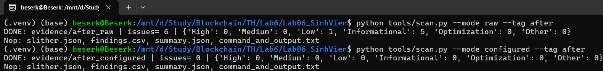
*Hình 5 – Scan AFTER: raw còn 6 (không còn High/Medium), configured còn 0.*

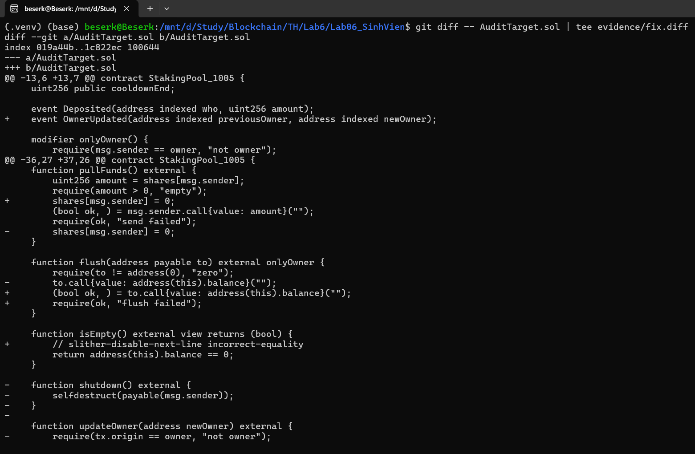
*Hình 6 – `git diff -- AuditTarget.sol | tee evidence/fix.diff` (phần đầu).*

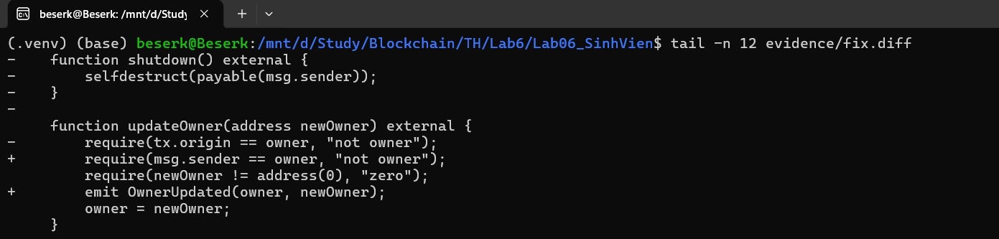
*Hình 7 – Phần cuối của fix.diff: `updateOwner` chuyển sang `msg.sender` và thêm `emit OwnerUpdated`.*

## 3. Kiến trúc / Inheritance (1,5 điểm)

- Lệnh printer đã chạy: `python tools/print_arch.py`. Script này gọi hai lệnh:
  `slither contracts/ArchitectureDemo.sol --print inheritance-graph --config-file config/slither.raw.json --fail-none` và
  `slither contracts/ArchitectureDemo.sol --print human-summary --config-file config/slither.raw.json --fail-none` (log nằm trong `evidence/architecture/printer_log.txt` và `human_summary.txt`).
  Script báo "Khong tim thay *.dot" (Hình 8) vì Slither 0.11.6 đặt tên file là `contracts/ArchitectureDemo.sol.inheritance-graph.dot`, khác với tên script tìm. Em đã copy file `.dot` vào `evidence/architecture/` rồi tự render bằng `dot -Tpng ... -o evidence/architecture/inheritance.png` (Hình 9).
- Ảnh `evidence/architecture/inheritance.png` (bản em đánh dấu thêm: `evidence/architecture/inheritance_marked.png`, Hình 11) có 3 contract: `StudentAsset` kế thừa (1) `AccessManaged` và (2) `BalanceLedger`. Theo `human_summary.txt` (Hình 10): có 3 contract, 23 dòng SLOC, không có lỗi High/Medium/Low, 1 lỗi optimization; `StudentAsset` có 4 hàm.
- Access control nằm ở **`AccessManaged`** (biến `admin` và `modifier onlyAdmin()` kiểm tra `msg.sender == admin`); logic số dư nằm ở **`BalanceLedger`** (`mapping balances` internal, `_credit()` internal để cộng số dư, `balanceOf()` chỉ đọc); contract triển khai nằm ở **`StudentAsset`** (hàm `mint(address,uint256)` có `onlyAdmin` và gọi `_credit()`).
- **Nên bắt đầu audit từ đâu:** Em sẽ bắt đầu từ `StudentAsset`, vì đây là contract được deploy và `mint` là hàm `external` duy nhất làm thay đổi state. Từ `mint` em đi theo hai hướng. Hướng thứ nhất là `onlyAdmin` trong `AccessManaged`: toàn bộ việc phân quyền phụ thuộc vào modifier này, mà `admin` chỉ được gán trong constructor và không có cách nào chuyển hay thu hồi quyền. Hướng thứ hai là `_credit` trong `BalanceLedger`, nơi trực tiếp thay đổi `balances`; cần chắc chắn `_credit` là `internal` và không có hàm nào khác ghi vào `balances`. Cuối cùng là kiểm tra thứ tự kế thừa (C3 linearization) để chắc không có hàm hay modifier nào bị override ngoài ý muốn.

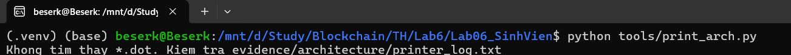
*Hình 8 – Chạy `print_arch.py`: script báo không tìm thấy file .dot vì khác tên.*

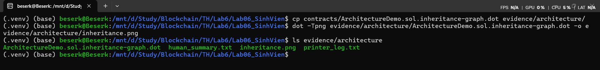
*Hình 9 – Copy file .dot vào evidence/architecture và render PNG bằng `dot`.*

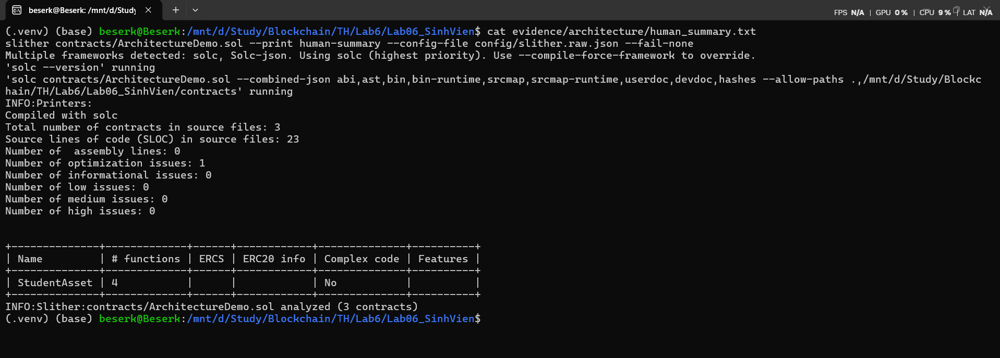
*Hình 10 – Nội dung `human_summary.txt`.*

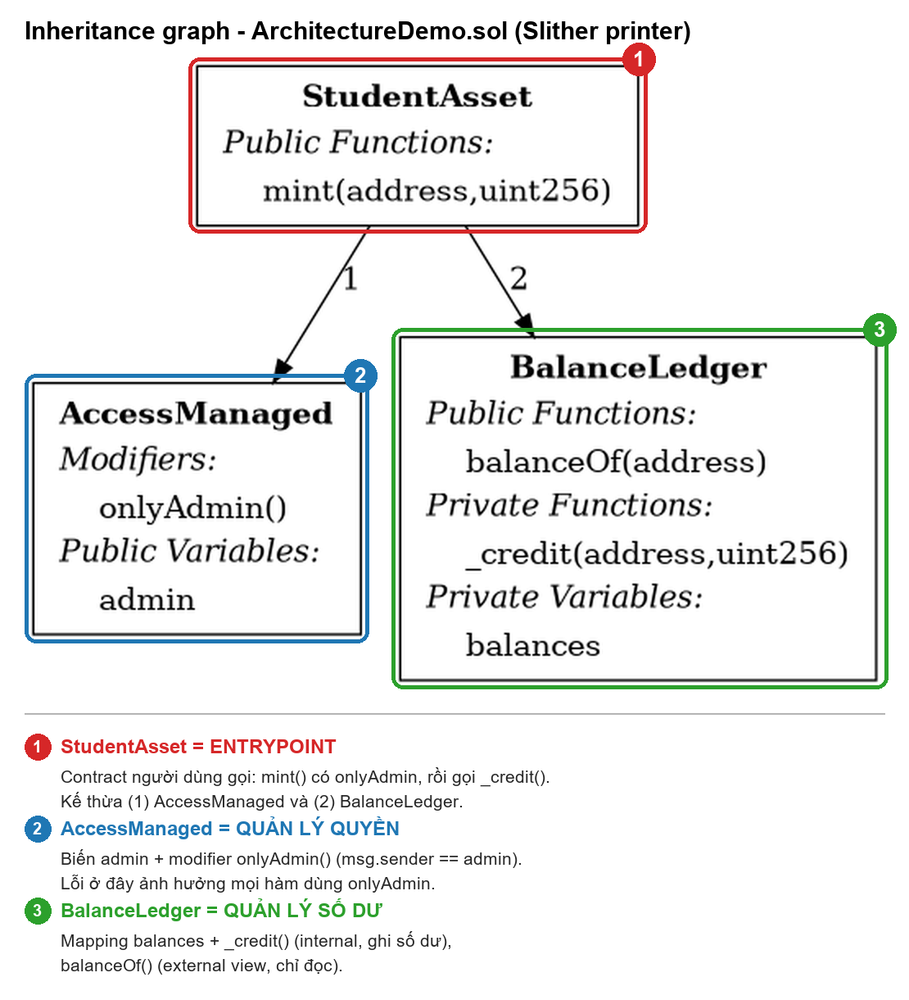
*Hình 11 – Inheritance graph có đánh dấu: entrypoint, quản lý quyền và quản lý số dư.*

## 4. Red -> Green CI (2,5 điểm)

Workflow `.github/workflows/slither.yml` dùng `crytic/slither-action@v0.4.2` với `solc-version: 0.8.24`, `slither-version: 0.11.6`, `slither-config: slither.config.json` và `fail-on: medium`.

| Phase | Commit (full/short SHA) | Run URL | Kết quả | Detector khiến RED / lý do GREEN |
|---|---|---|---|---|
| Baseline vulnerable | `170fc198099b1cf52eae0a06009ee0400c55be39` / `170fc19` | https://github.com/Longtemp145/nt547-lab06/actions/runs/44658794841 | RED | `reentrancy-eth`, `suicidal` (High); `incorrect-equality`, `tx-origin`, `unchecked-lowlevel` (Medium). Log ghi "5 result(s) found", từ Medium trở lên nên step Slither fail. |
| Patched | `15a4c0b674c2615fe8b4ee438a0c1125037364f4` / `15a4c0b` | https://github.com/Longtemp145/nt547-lab06/actions/runs/44660590351 | GREEN | 4 lỗi thật đã sửa, 1 FP được suppress đúng dòng; Low và Info bị `exclude_low/informational` loại ra, log ghi "0 result(s) found". |

- **So sánh local `--fail-none` với CI `fail-on: medium`:** Ở máy, `scan.py` chạy với `--fail-none` nên Slither luôn trả exit code 0 và lưu đủ JSON, CSV làm bằng chứng, kể cả khi có lỗi High (summary ghi `process_exit_code: 0`). Trên CI thì `fail-on: medium` biến Slither thành cổng chặn: chỉ cần một finding từ Medium trở lên là job đỏ. Vì vậy cùng một bản baseline, ở máy thì "11 findings, exit 0" còn trên GitHub thì RED.
- **Tác động của `exclude_low/informational`:** ở bản baseline, số finding hiển thị giảm từ 11 xuống 5; sau khi sửa thì giảm từ 6 xuống 0. Hai tuỳ chọn này chỉ ẩn Low và Info khỏi output và khỏi cổng CI, không đụng tới High/Medium (bài không dùng `exclude_medium`/`exclude_high`). Do đó các finding Low/Info vẫn phải được triage dựa trên bản raw, như em đã làm ở mục 2.

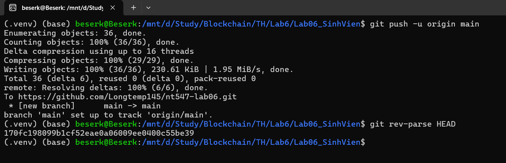
*Hình 12 – Push baseline lên GitHub, `git rev-parse HEAD` cho SHA #1 = 170fc19….*

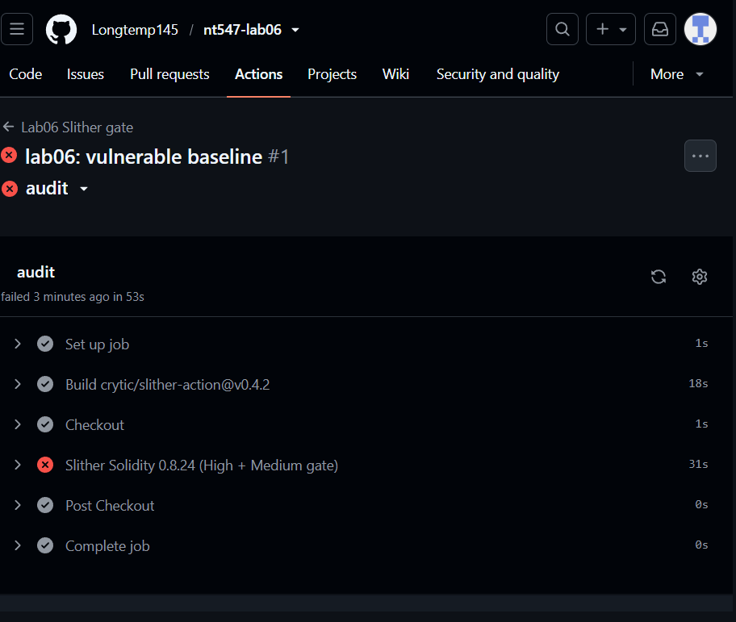
*Hình 13 – Run #1 (baseline): các bước setup đều qua, chỉ step Slither bị đỏ.*

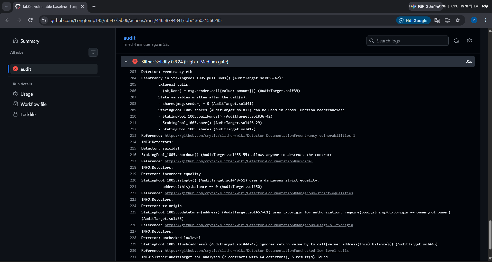
*Hình 14 – Log run #1: 5 detector và dòng "5 result(s) found".*

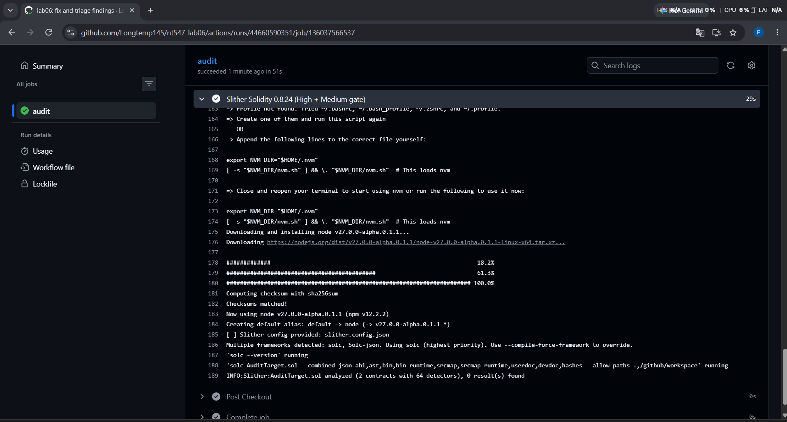
*Hình 15 – Run #2 (bản đã sửa, commit 15a4c0b): job thành công, log ghi "0 result(s) found".*

Ngoài 4 run chính, trên tab Actions còn vài run phụ (đều GREEN, không thuộc chuỗi chấm): run #3 `5c9c23a` là commit evidence kiến trúc (runs/44662193923, Hình 16); run #4 `0d7689c` là lần mutation trong modifier (runs/44664136136, xem mục 5); run #5 `c280da8` là lần revert mutation đó (runs/44664589162); run #8 `7a0ce62` là commit báo cáo.

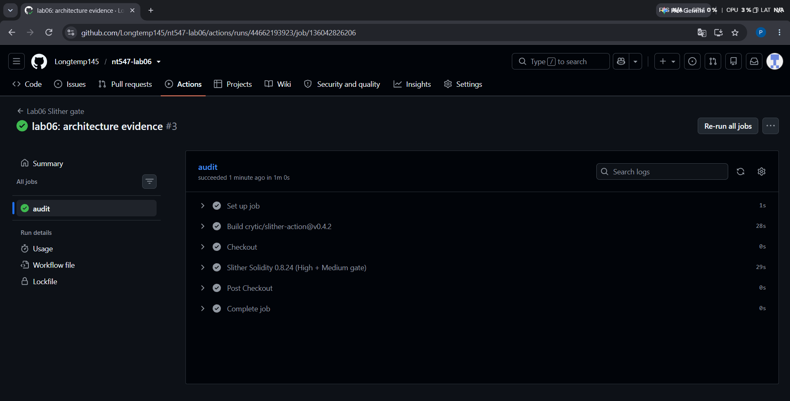
*Hình 16 – Run phụ của commit "lab06: architecture evidence": GREEN.*

## 5. Mutation RED -> GREEN (1,5 điểm)

- Mutation một dòng: `require(msg.sender == owner, "not owner")` -> `require(tx.origin == owner, "not owner")` trong `modifier onlyOwner`.
- Detector kỳ vọng: `tx-origin` (mức Medium). Kết quả em thực tế thu được:
  - **Làm đúng theo đề (đổi trong `modifier onlyOwner`, dòng 19):** chạy `python tools/scan.py --mode configured --tag mutation_modifier` ở máy thì ra **0 issue** (Hình 17, `evidence/mutation_modifier_configured/`). Em đã push commit này (`0d7689c`) và run https://github.com/Longtemp145/nt547-lab06/actions/runs/44664136136 vẫn **GREEN**. Đây là một trường hợp **false negative** của Slither 0.11.6: detector `tx-origin` chỉ duyệt các hàm (`contract.functions`), không duyệt modifier (`contract.modifiers`). Vì vậy `tx.origin` trong modifier không bị báo, dù lỗ hổng là có thật và ảnh hưởng tới mọi hàm dùng `onlyOwner`. Em đã revert lại bằng commit `c280da8` (runs/44664589162).
  - **Mutation tương đương để kiểm tra cổng CI:** em đổi đúng một dòng kiểm tra quyền trong `updateOwner` (dòng 57), cùng kiểu lỗi `msg.sender` -> `tx.origin`. Scan ở máy với `--tag mutation_check` ra 1 issue (`tx-origin`, Medium) (Hình 18). Trên CI, log ghi `Detector: tx-origin`, `StakingPool_1005.updateOwner(address) (AuditTarget.sol#56-61) uses tx.origin for authorization … (AuditTarget.sol#57)`, "1 result(s) found", nên run **RED** (Hình 19). Sau khi revert, log ghi "0 result(s) found" và run **GREEN** (Hình 20, Hình 21).

| Phase | Commit SHA | Run URL | Kết quả |
|---|---|---|---|
| Mutation | `ef55d34b0d8899c7310c61195dcee7016873a62b` | https://github.com/Longtemp145/nt547-lab06/actions/runs/44664931697 | RED |
| Revert mutation | `e1b2157b30517be37c4dbf1ee2f7735a8aaf3d9d` | https://github.com/Longtemp145/nt547-lab06/actions/runs/44665216157 | GREEN |

- **Nguồn định danh thay đổi thế nào:** `msg.sender` là địa chỉ **gọi trực tiếp** hàm hiện tại, có thể là ví người dùng hoặc một contract trung gian. Còn `tx.origin` là **ví (EOA) đã ký giao dịch ban đầu**, và giá trị này giữ nguyên qua mọi lời gọi lồng nhau. Khi đổi sang `tx.origin`, contract không còn kiểm tra "ai đang gọi mình" mà chỉ kiểm tra "ai bắt đầu giao dịch". Nếu owner lỡ tương tác với một contract độc hại (ví dụ trang airdrop hay mint NFT giả), contract đó có thể gọi tiếp `updateOwner(attacker)` và vẫn qua được kiểm tra vì `tx.origin == owner`. Kết quả là quyền owner bị chiếm dù owner không hề trực tiếp gọi `updateOwner`. Thêm nữa, `tx.origin` luôn là EOA nên cách kiểm tra này cũng không dùng được với ví multisig hay smart-contract wallet.

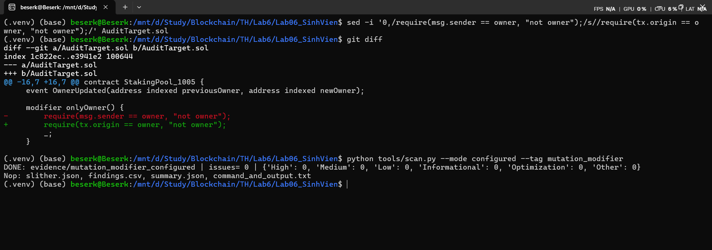
*Hình 17 – Đổi `msg.sender` thành `tx.origin` trong `modifier onlyOwner`: scan configured ra 0 issue (false negative).*

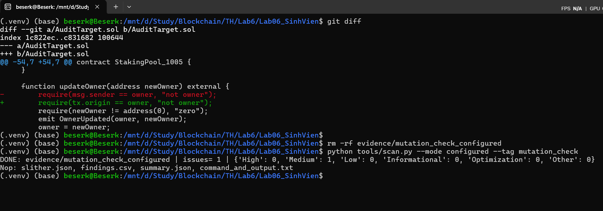
*Hình 18 – Đổi đúng 1 dòng trong `updateOwner`: diff chỉ 1 dòng -/+, scan configured ra 1 issue Medium.*

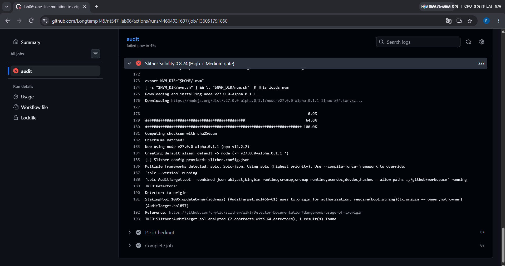
*Hình 19 – Run mutation (commit ef55d34) RED: `Detector: tx-origin` ở `AuditTarget.sol#57`, "1 result(s) found".*

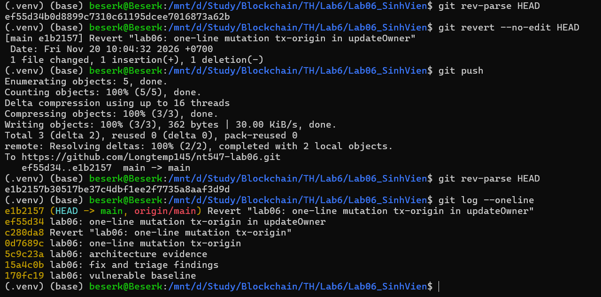
*Hình 20 – `git revert`, push, SHA #4 = e1b2157… và toàn bộ `git log --oneline`.*

*Hình 21 – Run revert (commit e1b2157) GREEN: "0 result(s) found".*

## 6. Bằng chứng, tự kiểm

Trước khi nộp, em đã tự rà lại từng mục:

- ✅ **`AuditTarget.sol`, `lab_identity.json`:** File contract trong repo là bản đã sửa và đã revert mutation (cả dòng 19 và dòng 57 đều dùng `msg.sender`). `lab_identity.json` giữ nguyên như lúc sinh, em không chạy lại `create_lab.py --force`.
- ✅ **`evidence/before_raw/` và `evidence/before_configured/`:** mỗi thư mục có đủ `slither.json`, `findings.csv`, `summary.json` và `command_and_output.txt` (Hình 3, Hình 4).
- ✅ **`evidence/after_raw/` và `evidence/after_configured/`:** cũng đủ 4 file như trên, kèm `evidence/fix.diff` lưu lại toàn bộ thay đổi (Hình 5 đến Hình 7).
- ✅ **`evidence/architecture/`:** có `human_summary.txt`, `printer_log.txt`, file `.dot`, `inheritance.png` và bản em đánh dấu `inheritance_marked.png` (Hình 8 đến Hình 11).
- ✅ **4 URL Actions và 4 commit SHA theo thứ tự RED/GREEN/RED/GREEN:** liệt kê trong bảng ở mục 4 và mục 5. Em đã mở lại từng link để đối chiếu SHA và kết quả trên GitHub. Nhánh `main` hiện đang GREEN.
- ✅ **Link repo và ảnh chụp:** các ảnh trong báo cáo (thư mục `evidence/screenshots/`) đều chụp nguyên terminal hoặc trang Actions, thấy được lệnh đã chạy, URL và commit SHA.
- ✅ **Triage bằng suy luận của mình:** mỗi finding trong bảng ở mục 2 đều có lý do dựa trên chính contract này (ai gọi được, gọi ra đâu, hậu quả là gì).
- ✅ **Không lộ thông tin nhạy cảm:** repo, báo cáo và ảnh chụp không có seed phrase, private key, mật khẩu hay token GitHub. Thông tin đăng nhập GitHub do git trên máy quản lý, không có token nào nằm trong file của repo.

Ngoài ra em giữ thêm hai thư mục bằng chứng cho phần mutation: `evidence/mutation_modifier_configured/` (0 finding, chứng minh false negative) và `evidence/mutation_check_configured/` (1 finding `tx-origin`). Cuối cùng em chạy `python tools/package_submission.py` để đóng gói bài nộp (Hình 22).

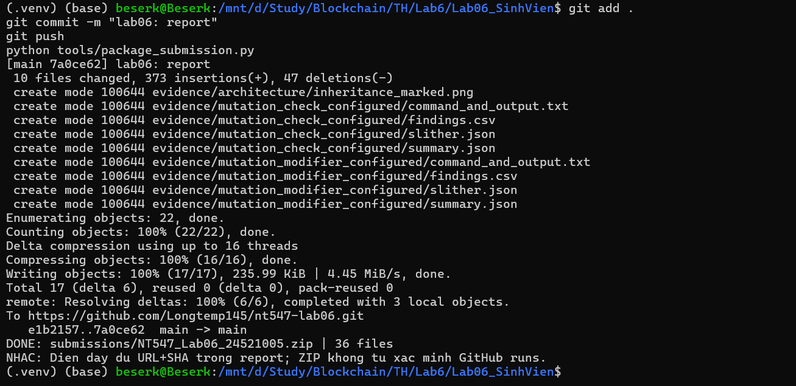
*Hình 22 – Commit báo cáo, push và chạy `package_submission.py` tạo `submissions/NT547_Lab06_24521005.zip`.*

**Nhận xét cuối cùng:** Qua bài này em thấy Slither rất hữu ích để tìm nhanh các mẫu lỗi quen thuộc: chỉ một lần scan đã chỉ ra đủ 5 lỗi Medium/High trong contract của em, và khi gắn vào GitHub Actions với `fail-on: medium` thì nó trở thành một cổng chặn rõ ràng, code còn lỗi thì không thể xanh. Tuy vậy, kết quả của tool vẫn cần người đọc lại: `incorrect-equality` bị xếp Medium nhưng thực tế vô hại, còn `timestamp` chỉ là Low và có thể chấp nhận. Phần em nhớ nhất là mutation trong modifier: lúc đầu em đổi đúng như đề nhưng CI vẫn xanh, tìm hiểu mới biết detector `tx-origin` không kiểm tra modifier. Từ đó em hiểu rằng CI xanh chỉ có nghĩa là "không có lỗi nào mà detector nhận ra", chứ chưa chắc contract đã an toàn. Vì vậy em nghĩ nên kết hợp thêm đọc code thủ công, viết test cho phần phân quyền (ví dụ test gọi qua một contract trung gian) và dùng thêm fuzzing. Khi phải tắt một cảnh báo, chỉ nên tắt đúng detector ở đúng dòng và ghi lại lý do để người review sau có thể kiểm tra lại.
